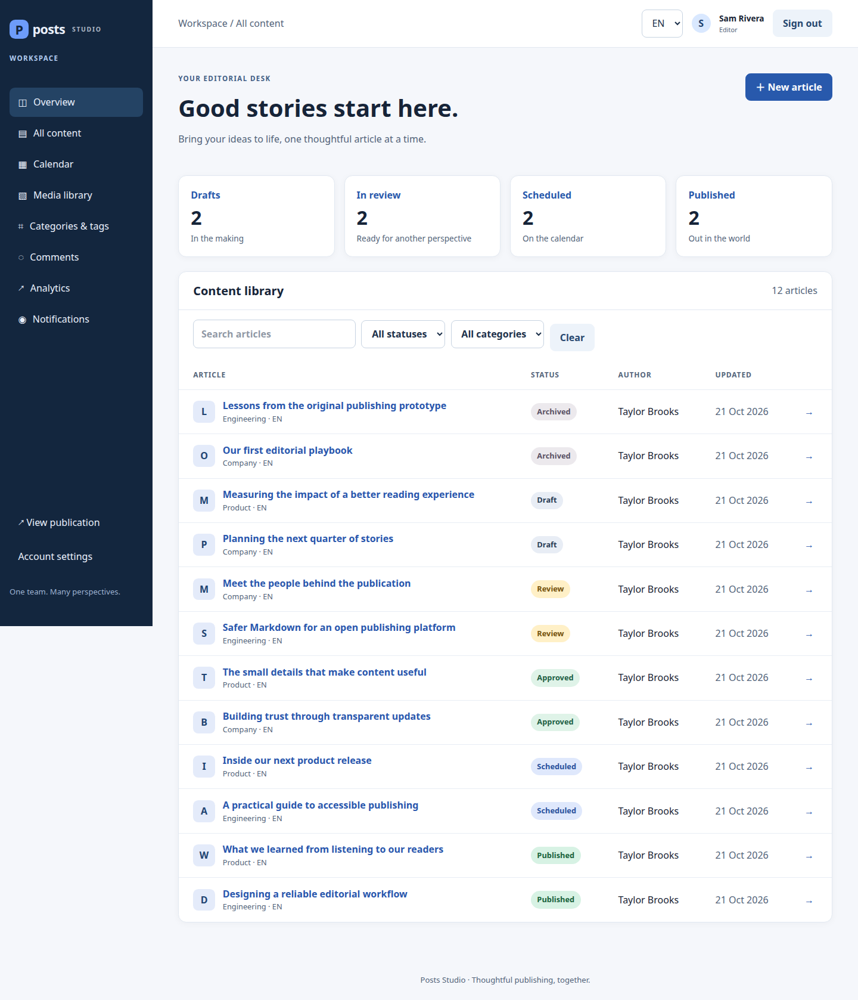
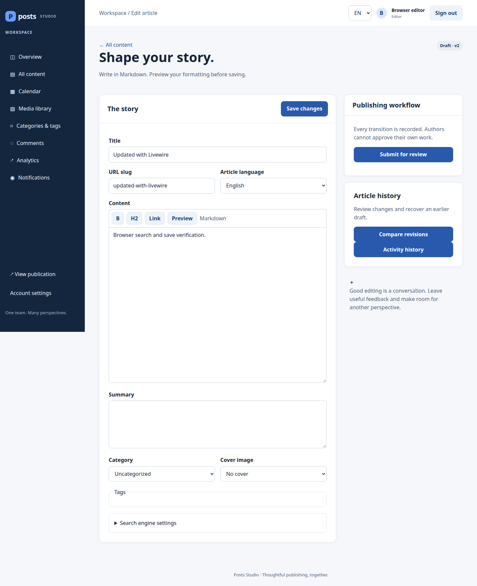
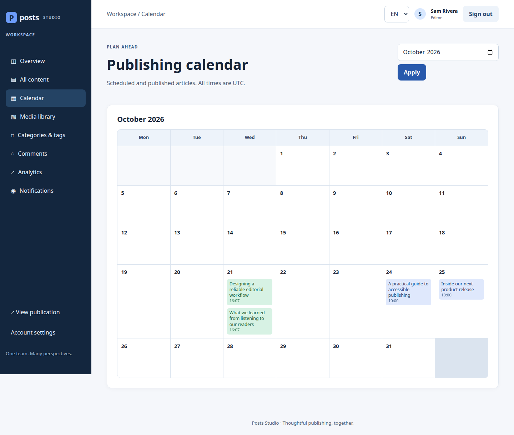
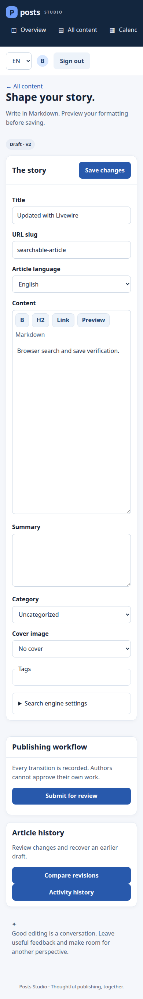

# Posts · Editorial publishing workspace

A Laravel 13 application for one editorial team, built with Livewire 4 and Tailwind CSS 4. Authors draft articles, independent reviewers approve them, and editors publish or schedule them.



## Application features

- Registration, email verification, password recovery, optional authenticator-based two-factor login, and single-use recovery codes.
- Author, reviewer, editor, and administrator roles enforced with policies.
- Draft → review → approved → scheduled/published → archived, including rejection feedback and reopening.
- Authors cannot approve their own work, including when they are administrators.
- Optimistic version checks prevent stale edits and transitions from overwriting newer changes.
- Revision comparison/restoration and transactional activity history.
- Livewire article editing with a dedicated Form object, safe Markdown preview, loading states, and validation feedback.
- Debounced content search, reactive filters, URL query state, and server-side pagination.
- Categories, tags, processed private media, moderated threaded comments, and publication SEO/sitemap.
- Scoped analytics, CSV export with formula neutralization, queued notifications, and a versioned Sanctum API.
- English and German interfaces.

Livewire updates the current browser. Different sessions do not receive pushed updates; concurrent writes are detected when they reach the server.

## Run locally with Docker Compose

Docker Engine and Docker Compose are the only host requirements. PHP, Composer, Node, and SQLite run inside the image.

```bash
git clone git@github.com:dionis1/posts.git
cd posts
docker compose up --build -d
```

Open [http://localhost:8000](http://localhost:8000). On PCs requiring privileged Docker access, prefix Docker commands with `sudo`.

Compose runs a one-time migration setup, the application, a queue worker, and Laravel's scheduler. The setup completes before the other processes start. SQLite data, uploads, sessions, logs, and the generated local encryption key persist in a named volume. These are local application processes; no CI or deployment tooling is included.

```bash
# Check startup and running processes:
docker compose ps -a
docker compose logs --tail=50 setup app queue scheduler

# Stop while preserving all local data:
docker compose down
```

**`docker compose down -v` deletes your local data and key.** Rebuild after changing source code. To use a different port:

```bash
APP_PORT=8001 docker compose up --build -d
```

Register as an author. Verification and password-reset email are written locally to the Laravel log:

```bash
docker compose exec app tail -n 100 storage/logs/laravel.log
```

Keep verification/reset links private. No real email provider or default administrator password is configured. Create a local administrator interactively:

```bash
docker compose exec app php artisan posts:admin admin@example.test
```

The command asks for credentials or confirms promotion of an existing account. The scheduler checks due articles every minute; the queue worker processes publishing, notifications, and media.

## Try the demo workspace

Seeding is optional and never runs on normal Docker startup. To add a realistic local dataset:

```bash
docker compose exec app php artisan db:seed --class=DemoSeeder
```

The seeder adds 12 articles (two in each workflow status), three categories, four tags, moderated/pending comments, sample view counts, and four verified team accounts:

| Role | Email |
| --- | --- |
| Administrator | `admin@demo.posts.test` |
| Editor | `editor@demo.posts.test` |
| Reviewer | `reviewer@demo.posts.test` |
| Author | `author@demo.posts.test` |

All newly created demo accounts use **`PostsDemo!2026`**. These public credentials are for local demonstrations only; the seeder refuses to run outside `local` and `testing`. Existing account credentials are preserved. A conflicting account role or article owner aborts the transaction instead of changing permissions or replacing content.

Log in as the editor to explore the full workspace, or as the author to check ownership restrictions. Articles pass through the real publishing actions, so revisions and activity history reflect independent approval. Notifications are suppressed during seeding. You can rerun the command: existing demo articles, edits, credentials, and personal data are preserved. Scheduled demo articles will publish when their due time arrives while the scheduler and queue are running.

`php artisan db:seed` calls the same seeder. Reusable Faker factories are available for users, posts, categories, tags, and comments, including published posts and approved comments. Factories create fixture records directly; use publishing actions when you need workflow history.

### Demo screenshots

These screenshots come from a separate database containing only synthetic demo data.





## Tests and code checks

```bash
docker compose exec app php artisan test
docker compose exec app vendor/bin/pest tests/Pest
docker compose exec app vendor/bin/pint --test
docker compose exec app composer audit
```

The test configuration overrides container settings and uses an isolated in-memory SQLite database, array sessions/cache/mail, and a test-only encryption key. Tests do not reset your personal application database.

The suite includes existing PHPUnit regression tests and new Pest tests. Coverage includes workflow policies, cross-author access, atomic rollback, stale updates, scheduled-job idempotence, revision restoration, API abilities, Livewire validation/events/state, search pagination, query duplication, second-factor expiry/replay/recovery, and media validation/processing. Eloquent lazy loading is prohibited in development and tests to expose missing eager loads.

### Browser checks

Build the image first. With Node 22 and npm available on your PC:

```bash
npm ci
npx playwright install chromium
npm run test:browser
```

Or use installed Chrome:

```bash
CHROME_BIN=/usr/bin/google-chrome npm run test:browser
```

The test runner starts a disposable Docker container on port 8010, migrates `/tmp/posts-browser.sqlite` inside it, and creates a test-only editor. This database is separate from the Compose volume. Browser checks cover public reading, registration, verification gating, localization, Markdown preview, Livewire saves/search, reload persistence, mobile overflow, and serious/critical axe accessibility findings. The container is removed afterward. README screenshots use the optional demo seeder in a separate database; automated checks do not replace manual accessibility review.

## Application architecture

- `app/Actions`: invokable publishing, comment, media, role, and taxonomy actions. Multi-table writes use transactions; file uploads compensate for failed database writes.
- `app/Livewire/PostEditor.php` and `Forms/PostForm.php`: component behavior separated from editable state and validation.
- `app/Livewire/PostLibrary.php`: scoped, eager-loaded, paginated queries with `#[Computed]` and debounced search.
- `app/Http/Requests`: validated and authorized HTTP/API inputs.
- `app/Support/PostContentRules.php`: shared content rules for actions, HTTP requests, and Livewire forms.
- `app/Policies`: permissions for posts, comments, media, users, categories, and tags.
- `app/Enums`: backed status/role enums cast on models.
- `app/Services/PostService.php`: compatibility facade delegating to publishing actions; it contains no publishing business rules.

See [architecture decisions](docs/ARCHITECTURE.md) for boundaries and tradeoffs.

## API

Editorial endpoints live under `/api/v1/posts`. They require Sanctum authentication, a verified email, the appropriate `read`/`write` token ability, and applicable policies. Pagination is bounded, filters are validated, and writes require the current `lock_version`. Web, API, and queued publication use the same publishing actions.

## Versions and scope

The committed lock files resolve stable Laravel 13 and Livewire 4 releases, with Tailwind CSS 4. The Docker image uses PHP 8.4 and Node 22; it is intended for local development. The existing users/posts schema is extended by migrations rather than replaced. Keep a copy of any existing data before applying schema changes.

This is one editorial workspace with SQLite full-text search. Multi-company isolation, collaborative real-time editing, external mail delivery, and public hosting are outside this implementation. Search on other database drivers uses a fallback; no MySQL/PostgreSQL verification is claimed.

## Mobile editor


